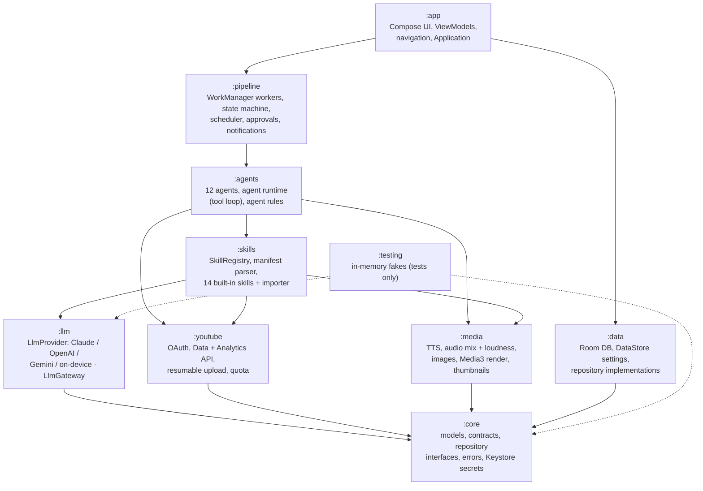
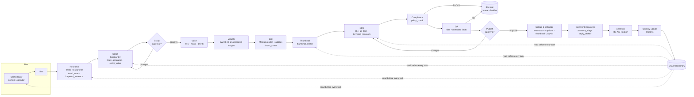
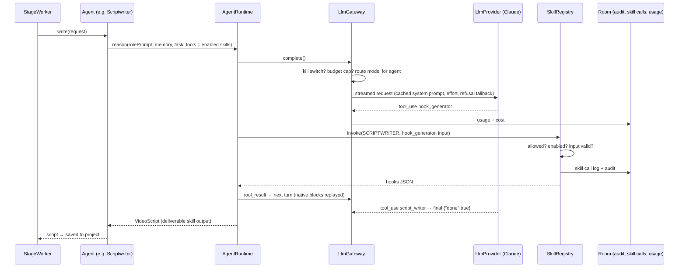

# TubePilot architecture

TubePilot is a team of twelve AI agents that runs a YouTube channel from an Android phone. Agents share one
persisted pipeline, use pluggable **skills**, read and write **channel memory**, and talk to YouTube only through
the official Data API v3 and Analytics API v2.

- **Language / UI:** Kotlin 2.2, Jetpack Compose (Material 3)
- **Architecture:** MVVM + Clean Architecture; domain contracts in `:core`, implementations in outer modules
- **DI:** Hilt · **Persistence:** Room + DataStore · **Background:** WorkManager · **Async:** Coroutines/Flow
- **Network:** OkHttp, Retrofit (YouTube), official Anthropic Java SDK (Claude) · **Media:** Media3 Transformer
- **Auth:** Google Identity Services `AuthorizationClient` (OAuth 2.0, scoped access tokens)
- **Secrets:** AES-256-GCM with a non-exportable Android Keystore key
- **Target:** compileSdk/targetSdk 36 (Android 16), minSdk 26, `arm64-v8a`

## 1. Module diagram



Dependencies point inwards: nothing depends on `:app`, and `:core` depends on nothing in the project. Every
repository is an interface in `:core` (`core/domain/Repositories.kt`), so agents, skills and the pipeline are tested
with the in-memory fakes in `:testing`.

## 2. Pipeline and data flow



Each box is one execution of `StageWorker` (WorkManager). After a stage the worker writes the artefact into the
project's JSON document in Room, computes the transition with the pure `PipelineEngine`, and enqueues the next stage
on the project's unique work chain. Process death or a reboot loses nothing: WorkManager persists the pending
request and stages are idempotent (finished renders are detected and skipped, upload sessions resume from the last
confirmed byte).

### Runtime sequence of one agent step



## 3. Agents

| # | Agent | Main skills | LLM tool loop | Output contract |
|---|---|---|---|---|
| 1 | Orchestrator (Channel Manager) | content_calendar, trend_scan | via skills | `WeekPlan`, started projects |
| 2 | Trend Researcher | trend_scan, keyword_research | yes | `IdeaList`, `ResearchBrief` |
| 3 | Scriptwriter | hook_generator, script_writer | yes (deliverable) | `VideoScript` |
| 4 | SEO Specialist | title_ab_test, keyword_research | yes | `SeoPackage` |
| 5 | Thumbnail Designer | thumbnail_maker | direct | `ThumbnailSet` |
| 6 | Voice & Audio | — (media engine) | no | `VoiceTrack` |
| 7 | Video Editor | subtitle_generator, shorts_cutter | direct | `VisualSet`, `EditResult` |
| 8 | Upload & Scheduler | — (YouTube client) | no | `List<UploadResult>` |
| 9 | Community Manager | comment_triage, reply_drafter | direct | `CommentRunSummary` |
| 10 | Analytics | analytics_report | direct | `WeeklyReport`, lessons |
| 11 | Compliance & Safety | policy_check | direct | `ComplianceReport` (can block) |
| 12 | QA | — (rules) | no | `QaReport` (can block) |

Every agent extends `agents/core/Agent` with a role prompt, memory focus, skill list and `RetryPolicy`. Contracts are
`@Serializable` data classes (`core/model/Contracts.kt`, `agents/contracts/AgentContracts.kt`); the LLM sees an
example of the exact JSON shape and the answer is decoded with one automatic repair round.

## 4. Skills system

A skill is a package: `skill.json` (id, name, description, JSON-Schema inputs/outputs, permissions, allowed agents,
default state, executor id) plus a prompt template (`prompt.md`, `{{variable}}` and `{{input.path}}` placeholders,
with `{{channel}}`, `{{style}}`, `{{lessons}}` and others filled from memory).

- Built-ins live in `skills/src/main/assets/skills/<id>/` and bind to Kotlin executors through a Hilt map
  (`SkillsModule`).
- `SkillRegistry` merges built-ins with user imports, tracks per-agent enable/disable overrides, exposes enabled
  skills as LLM tools, validates inputs, enforces the kill switch and logs every call (`skill_calls` table + audit).
- **Imports are sandboxed:** `.zip` (skill.json + prompt) or single-JSON packages, size-limited and never written to
  disk. Imported skills must use the generic prompt executor and may only request `LLM` and `MEMORY_READ`, so they
  can never upload, post, moderate or touch files.

## 5. Memory and learning

Room tables: `kv` (channel profile and style guide as JSON documents), `lessons`, `performance`, `projects`,
`calendar`, `comments`, `weekly_reports`, `audit`, `llm_usage`, `quota_usage`, `skill_state`, `imported_skills`,
`skill_calls`, `agent_status`. `MemoryContextBuilder` injects profile, style guide, the lessons relevant to the
agent's focus, and (for research and analytics) recent performance into every system prompt. The Analytics agent
writes evidence-backed lessons weekly; near-duplicates are filtered by shingle similarity, and the user can switch
any lesson off.

## 6. LLM layer

`LlmProvider` has four implementations: **Anthropic** (official Java SDK, streaming with `MessageAccumulator`,
cached system prompt, explicit `effort`, server-side refusal fallback, native block replay for tool loops), **OpenAI**
(Chat Completions SSE with function calling), **Gemini** (`streamGenerateContent` SSE with function declarations and
thought-signature replay) and **on-device** (MediaPipe LLM Inference with a user-supplied model; tools via a JSON
envelope). `LlmGateway` routes each agent to its configured model, checks the kill switch and the monthly budget
(auto-pause), retries transient errors with jittered backoff, optionally falls back on-device, and records tokens and
cost per call.

## 7. YouTube layer

- **OAuth:** scopes `youtube.upload`, `youtube.force-ssl`, `yt-analytics.readonly` via `AuthorizationClient`. The app
  is identified by package name and signing SHA-1, so no client secret ships in the APK; background work gets tokens
  silently, and a 401 invalidates the token and retries once.
- **Quota:** `QuotaManager` keeps a local per-Pacific-day counter per bucket. The cost table ships as
  `quota_costs.json` (verified against Google's quota-cost page on the date it records), can be edited in Settings
  or refreshed from a URL, and models the separate `videos.insert` and `search.list` call buckets. Calls that would
  overrun throw `QuotaExhaustedException`; the pipeline re-queues them after the reset. Research prefers the 1-unit
  uploads-playlist path over `search.list`.
- **Uploads:** resumable protocol with 8 MiB chunks, server-confirmed checkpoints persisted per project, session
  re-sync after failures and transparent re-creation when a session expires. Scheduled publishing uses
  `privacyStatus=private` + `publishAt`; `containsSyntheticMedia` carries the AI disclosure.
- **Policy:** only official endpoints. The API cannot pin comments, so the pinned comment is posted and the UI asks
  the user to pin it in Studio.

## 8. Media layer (on-device)

Canonical audio is 48 kHz mono PCM. `AudioConverter` (MediaCodec) decodes any input, `AudioMixer` ducks looped music
under the voice with fades, and `LoudnessMeter` measures ITU-R BS.1770-4 integrated loudness and normalises to the
target (default -14 LUFS) with a soft limiter, all streaming in 100 ms blocks. `VideoRenderer` builds a Media3
`Composition` (image or B-roll sequence + audio sequence) with crop-to-fill presentation, Ken Burns motion,
fade-through-black transitions and bitmap overlays for burned-in captions and headlines, then hardware-encodes H.264/AAC
to a temp file that is renamed on success. `ThumbnailCompositor` draws 1280×720 variants under 2 MB.

## 9. Safety defaults

Approval mode on · comment replies are drafts unless auto-post is enabled · sensitive comments never auto-answered ·
kill switch cancels all queued and running work · monthly budget cap auto-pauses · Compliance and QA can block
publishing (overrides need a written justification and are logged as security events) · every agent, skill, LLM call
and user decision is in the audit log · visuals must be generated or from the user's own library (unknown media is a
blocker) · secrets are Keystore-encrypted and excluded from backups.

## 10. Gradle project structure

```
TubePilot/
├── settings.gradle.kts            # modules + Google-hosted Maven Central mirror
├── build.gradle.kts               # shared Android library config (SDK levels, JVM 17)
├── gradle/libs.versions.toml      # version catalog
├── app/                           # :app — Application, MainActivity, ui/<screen>/ (10 screens + detail screens)
│   ├── proguard-rules.pro         # R8 rules (Anthropic SDK, MediaPipe, serialization)
│   └── src/main/res/xml/          # backup exclusions, HTTPS-only network config
├── core/      src/main/kotlin/com/tubepilot/core/{model,domain,error,util,security,di}
├── data/      src/main/kotlin/com/tubepilot/data/{db,repo,settings,di}
├── llm/       src/main/kotlin/com/tubepilot/llm/{provider,di}
├── youtube/   src/main/kotlin/com/tubepilot/youtube/{auth,api,upload,quota,di}  + assets/quota_costs.json
├── media/     src/main/kotlin/com/tubepilot/media/{audio,tts,image,library,subtitle,video,thumbnail,probe}
├── skills/    src/main/kotlin/com/tubepilot/skills/{builtin,di}   + assets/skills/<14 skills>/{skill.json,prompt.md}
├── agents/    src/main/kotlin/com/tubepilot/agents/{core,contracts}
├── pipeline/  src/main/kotlin/com/tubepilot/pipeline/{work}
├── testing/   shared fakes for unit tests
└── docs/      ARCHITECTURE.md, BUILD.md, GOOGLE_CLOUD_SETUP.md, API_KEYS.md, SKILLS.md
```
