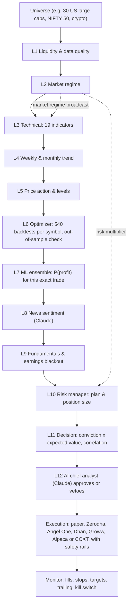

# Multi-Agent AI Trading Desk

A team of specialist AI agents that screens a market layer by layer and hands only the strongest,
risk-managed trade setups to execution. Every agent has one job. It reads what earlier agents
concluded, publishes its own findings on a shared message bus, and either passes a candidate on
or rejects it with a reason. Whatever survives all twelve layers becomes an exact trade plan
(entry, stop-loss, take-profit, size) that can be paper traded or sent to a live broker.

> **Read this first.** No system can promise profitable trades. This one tries to rank trades by
> *expected value*, and it only trusts edges that held up on data the optimizer never saw. Even so,
> past results don't guarantee future ones. Paper trade it for weeks before risking money, and never
> risk money you can't afford to lose.

## How the funnel works



The cheap, broad filters come first. Backtests, machine learning, news and Claude only run on the
few candidates that survive, so a scan of 30 symbols takes well under a minute.

| Layer | Agent | Its job | Rejects when |
|---|---|---|---|
| L1 | Liquidity & Data-Quality Screener | Checks history, freshness, price and turnover | data is missing, stale or suspicious, or trading is thin |
| L2 | Market Regime Analyst | Reads the benchmark's trend, a volatility index (VIX, India VIX) or realized volatility, and breadth. Broadcasts the regime and sets each symbol's direction from its primary trend | market is in crisis; symbol trends down and shorting is off; a long lags the benchmark in a bear market |
| L3 | Technical Indicator Analyst | Scores 19 indicators: MA stack, EMA cross, ADX/DMI, SuperTrend, regression slope, RSI, MACD, stochastic, ROC, Williams %R, CCI, OBV, MFI, CMF, volume thrust, Bollinger, Donchian, relative strength | confluence in the trade's direction is below the threshold, which the regime raises in hostile markets |
| L4 | Multi-Timeframe Analyst | Weekly EMAs, MACD and RSI; monthly 10-month SMA and 12-month momentum | higher timeframes disagree with the daily trade |
| L5 | Price Action & Levels Analyst | Swing support and resistance, room to the next level, extension from the 20-day EMA, candlestick patterns, 52-week range | price is pinned under resistance or over-extended |
| L6 | Strategy Optimizer & Backtester | Tests 15 setup variants (trend pullback, breakout, momentum, mean reversion, SuperTrend flip, MACD cross), each against 36 exit settings: stop 1-2.5 ATR, target 1.5-3R, hold 5-20 bars, 540 backtests in all. Picks the winner on the first 70% of history, validates it on the last 30%, and checks that neighbouring settings also work | no setup survives out of sample, or no validated setup is firing on today's bar |
| L7 | Machine-Learning Forecaster | Gradient boosting + random forest + logistic regression. Purged walk-forward validation predicts whether this exact trade (same stop, target and time exit) ends in profit | no out-of-sample skill (AUC), probability too close to break-even, or today scores below average |
| L8 | News & Sentiment Analyst | Recent headlines, scored by Claude (or a finance word list without it) | the news flow is strongly against the trade |
| L9 | Fundamental & Event-Risk Analyst | Margins, growth, ROE, leverage, valuation and analyst ratings; next earnings date | weak business quality for a long, or earnings within the blackout window |
| L10 | Risk Manager | Entry, ATR stop, target, and size from the risk budget (1% of equity by default, scaled by the regime); position, heat and cash limits | the size rounds to zero, or a limit is reached |
| L11 | Chief Decision Maker | Weighted conviction across agents × expected value (half backtest, half ML). Ranks, keeps the top N and enforces correlation, heat and cash across the picks | conviction or expected value is too low, the pick ranks below the top N, or it is too correlated with a better pick |
| L12 | AI Chief Analyst (Claude) | Reads every agent's report, weighs the bull and bear case, and approves or vetoes | it finds a material problem the scores hide |
| -- | Execution Trader | Kill switch, daily loss limit and order-size cap, then sends entry + stop-loss + take-profit | a safety rail is tripped |
| -- | Position Monitor | Fills pending paper orders. Applies stops, targets, break-even trailing and time exits, and trips the kill switch on the daily loss limit | -- |

### How the agents talk to each other

* **Message bus (publish/subscribe).** Agents broadcast what they learn, and other agents react.
  The regime analyst publishes `market.regime`. The technical analyst subscribes and demands more
  confluence in hostile markets, and the risk manager subscribes and shrinks position sizes when
  volatility is high. The decision maker publishes `decision.final` for execution, execution
  publishes `order.submitted`, and the monitor publishes `position.closed` and `risk.alert`.
* **Blackboard (shared dossiers).** Each symbol has a dossier that every agent appends its report
  to: pass or fail, a 0-1 score, reasons and data. Later agents read earlier ones. The ML agent
  trains on the exact stop, target and holding period the optimizer chose. The risk manager sizes
  with them. The decision maker weighs every score, and Claude reviews the complete dossier.

### What "most profitable" means here

Trades are ranked by **conviction × expected value in R**. R is the amount risked: a +0.4R trade
is expected to make 40% of the money put at risk. Position size fixes the money at risk, so a
higher expected R means a higher expected profit for the same risk. The expected value blends two
independent estimates:

1. the out-of-sample average result of the chosen setup;
2. the ML ensemble's probability of a profitable outcome, combined with that setup's historical
   average win and loss.

Conviction is the weighted agreement of all agents. The top picks must also be uncorrelated with
each other and fit within the portfolio's risk, heat and cash limits.

## Quick start

```bash
cd ai-trading
pip install -r requirements.txt

python -m trader agents                       # meet the team
python -m trader scan --synthetic --no-ai -v  # offline demo on generated data, shows every rejection
python -m trader scan                         # real data: 30 US large caps vs SPY and VIX
python -m trader scan --preset nifty50        # NSE large caps vs NIFTY 50 and India VIX
python -m trader scan --preset nifty500       # any Indian list: midcaps, smallcaps, sectors, F&O, ETFs
python -m trader scan --preset crypto         # 12 major coins vs BTC
python -m trader scan --preset us_etfs --symbols SPY,QQQ,GLD,TLT   # your own list
```

Each scan prints the funnel, the final trade cards and the closest misses. It also saves a
Markdown and a JSON report in `reports/`.

Example trade card:

```
#1  NVDA  LONG   setup: trend_pullback(rsi2=10)
    entry ~182.40   stop 176.10   target 195.00   (2.0R, exit after 10 bars at the latest)
    size 117   value 21,341   risk 737 (0.74% of equity)
    conviction 0.71   expected value +0.38R   ML P(profit) 58% (walk-forward AUC 0.56)
    backtest  in-sample 41 trades PF 1.92 +0.36R | out-of-sample 17 trades PF 1.71 +0.31R | robust 78%
```

(Illustrative layout. Real numbers come from your scan.)

## Paper trading (the default)

```bash
python -m trader trade      # scan, then place paper orders (they fill at the next open)
python -m trader monitor    # after each session: fills, stops, targets, trailing, time exits
python -m trader status     # equity, open positions, closed trades, win rate, average R
```

The paper account starts with 100,000 and lives in `state/paper_account.json`. Every order and
exit is appended to `state/journal.csv`. Synthetic runs use `state/synthetic/` so they never mix
with your real paper account.

Schedule it on a computer that stays on. For example, US markets on weekdays (crontab, local
time is New York):

```cron
30 16 * * 1-5  cd /path/to/ai-trading && python -m trader monitor >> state/cron.log 2>&1
45 16 * * 1-5  cd /path/to/ai-trading && python -m trader trade   >> state/cron.log 2>&1
```

## Claude-powered agents (optional)

The news analyst (L8) and the chief analyst (L12) use Claude when credentials are available:

```bash
pip install anthropic
export ANTHROPIC_API_KEY=sk-ant-...
python -m trader scan            # "AI review on" appears in the first line
```

* The model is `claude-opus-5-5` (`[llm] model` in the config). News scoring runs at low effort
  with one batched call per scan. The final review runs at high effort with one call per
  finalist, so a scan costs a few calls, not one per symbol.
* Answers use structured outputs (a JSON schema), so they are always machine-readable.
* **Server-side refusal fallback is enabled** (`fallbacks: "default"`). If a safety classifier
  declines a request, the API retries it on Anthropic's recommended fallback model instead of
  failing. Remove it in `trader/llm.py` if you'd rather not.
* Without credentials everything still works: the news analyst falls back to a word list and the
  AI review is skipped. Set `[llm] required = true` to drop any trade Claude couldn't review.

## Going live

Live trading is off unless you do **all** of the following:

1. Paper trade for several weeks and compare `status` results with what the backtests promised.
2. Copy `config.example.toml` to `config.toml` and pick a broker:
   * **Alpaca** (US stocks, ETFs, crypto): set `APCA_API_KEY_ID` and `APCA_API_SECRET_KEY`, then
     `[execution] broker = "alpaca"`. Without `--live` it uses Alpaca's own paper account, which
     is a good second rehearsal. Stock entries are bracket orders, so the stop and target sit on
     Alpaca's servers.
   * **Crypto exchanges via CCXT** (Binance, Bybit, Kraken, ...): `pip install ccxt`, set
     `CCXT_API_KEY` and `CCXT_SECRET`, then `[execution] broker = "ccxt"` and `ccxt_exchange`.
     Without `--live` it uses the exchange's testnet. Spot has no bracket orders, so the monitor
     enforces stops: run `monitor` every few minutes.
3. Pass `--live` and type `LIVE` at the prompt, or add `--yes` in a scheduler:
   ```bash
   python -m trader trade -c config.toml --live
   python -m trader monitor -c config.toml --live
   ```

Safety rails that are always on:
* `risk_per_trade` is capped at 5% (default 1%).
* Orders above `max_order_value` are blocked.
* `max_open_positions` and `max_portfolio_heat` limit total risk.
* If equity falls more than `max_daily_loss_pct` (default 3%) in a day, the monitor creates
  `state/KILL_SWITCH`. No new orders go out until you delete that file.
* Synthetic data can never be traded live.

For **Zerodha, Angel One, Dhan or Groww** (shares, intraday, futures and options), see the next section.

Other brokers (Interactive Brokers, Upstox, Fyers, ...) can be added by implementing the small
`Broker` interface in `trader/brokers/base.py`: `account`, `positions`, `submit` and `manage`. An
Indian broker only needs the primitives in `trader/brokers/india.py`.

## Indian market: every share, index, ETF, future and option

### What can be scanned

| Preset | What it covers |
|---|---|
| `nifty50`, `nifty_next50`, `nifty100`, `nifty200`, `nifty500` | NIFTY large-cap and broad-market indices |
| `nifty_midcap150`, `nifty_smallcap250`, `nifty_total_market` | mid caps, small caps, and about 750 shares across all sizes |
| `nse_all` | every share listed on NSE (EQ series; around 2,000 shares, so a scan takes a while) |
| `nse_fo` | every underlying with futures and options, indices included |
| `nifty_bank`, `nifty_it`, `nifty_pharma`, `nifty_auto`, `nifty_fmcg`, `nifty_metal`, `nifty_energy`, `nifty_realty`, `nifty_psu_bank`, `nifty_fin_service` | sectors |
| `india_etfs` | NIFTYBEES, BANKBEES, GOLDBEES, SILVERBEES and other liquid ETFs |
| `india_indices` | NIFTY 50, Bank Nifty, Fin Nifty, Midcap Select, Next 50 and SENSEX, for futures and options |

Index lists change twice a year. The desk downloads NSE's current list, caches it for a week, and
falls back to a built-in list when NSE can't be reached. BSE shares work with `.BO` symbols.
Every preset is measured against NIFTY 50 and India VIX.

### Four ways to trade: `[india] segment`

| Segment | Product | Direction | Size | Protection and exits |
|---|---|---|---|---|
| `delivery` (default) | CNC | long only | shares | stop-loss and target wait at the broker (GTT); stop to break-even after +1R; exit after the holding period |
| `intraday` | MIS | long and short | shares | stop-loss order at the exchange; the monitor watches the target and squares everything off at 15:10 IST |
| `futures` | NRML | long and short | lots, from the risk budget (points to the stop × lot size) | stop-loss order every session; the monitor handles target, holding-period and expiry exits |
| `options` | NRML | buys a call for a long signal, a put for a short one | lots, from the premium (the whole premium counts as risk) | exits when the underlying reaches its stop or target; a stop-loss order on the premium (-50%) as a backstop; out before expiry |

The analysis adapts to the segment:
* intraday backtests only test trades that close the same day;
* short signals are enabled outside delivery;
* options keep holding periods to 10 days or less, because of time decay.

Futures use the nearest expiry at least `min_days_to_expiry` (7) days out. Options use the same
rule and the at-the-money strike, or one strike out of or into the money with
`option_strike = "otm1"` or `"itm1"`. Lot sizes, strikes and expiries come from your broker's
instrument list, so they are always current. The desk only buys options: it never sells (writes)
them.

### Brokers: Zerodha, Angel One, Dhan and Groww

| Broker | Install | Credentials (environment variables) | Daily login | Delivery exits |
|---|---|---|---|---|
| Zerodha | `pip install kiteconnect` | `KITE_API_KEY`, `KITE_API_SECRET` | `python -m trader login --broker zerodha` once a day (Kite sessions end at 06:00 IST) | one GTT OCO: the leg that fires cancels the other |
| Angel One | `pip install smartapi-python` | `ANGEL_API_KEY`, `ANGEL_CLIENT_CODE`, `ANGEL_PIN`, `ANGEL_TOTP_SECRET` | automatic, using TOTP | two GTT rules |
| Dhan | `pip install dhanhq` | `DHAN_CLIENT_ID` plus `DHAN_ACCESS_TOKEN`, or `DHAN_PIN` and `DHAN_TOTP_SECRET` | automatic with PIN and TOTP | two Forever Orders |
| Groww | `pip install growwapi` | `GROWW_API_KEY` plus `GROWW_TOTP_SECRET` (or `GROWW_API_SECRET`, which you approve in the app daily) | automatic with TOTP | two GTT smart orders |

All four support every segment. `*_TOTP_SECRET` is the key shown when you enable an
authenticator app for the API, not a 6-digit code. The desk generates the codes itself.

### How a trade runs

* **Delivery:** run `trade` after the close (around 16:10 IST). It sends a limit buy 1% above the
  close as an after-market order. Groww's API takes no after-market orders, so there the entry
  waits for the open. A gap up of more than 1% means no fill, on purpose: the desk does not
  chase. Once the order fills, the stop-loss and target go to the broker's servers and keep
  working when your computer is off. Both move with the fill price, so the risk and reward match
  what the backtest validated.
* **Intraday, futures and options:** `trade` after the close queues the signals. The first
  monitor run of the next session sends the entries at live prices, which futures and option
  sizing need. Intraday entries that haven't started by 10:30 are dropped.
* After a fill, a stop-loss order protects the position (re-placed every session, since such
  orders last one day). The monitor exits on the target, at 15:10 for intraday, after the holding
  period, or a day before expiry.
* Before any exit, the monitor confirms the stop-loss order is cancelled and the position still
  exists. That way a stop that fills at the same moment can never turn into a second, opposite
  position.

### Before going live

* **Static IP:** SEBI's retail algo-trading rules require API orders to come from a static IP
  registered with your broker in its developer console (Dhan's API can also set it). Run the
  desk on that machine, or on a VPS with that IP.
* **DDPI:** activate DDPI (Demat Debit and Pledge Instruction) so your broker can sell delivery
  shares when a stop fires. Without it every sale needs a TPIN/eDIS authorisation, and automatic
  stops will fail.
* **F&O:** your account needs the F&O segment activated and enough margin.
  * Futures are leveraged: a gap past the stop can lose more than the planned risk.
  * An option premium can fall to zero.
* **Order size:** `max_order_value` is in rupees for these brokers. It caps one delivery or
  intraday order, the notional value of one futures order (`2500000` lets one NIFTY lot through),
  and the premium of one options order.
* The desk never trades a share you already hold outside it. Its positions and limits count only
  what it opened itself.

**Dry run first.** These brokers have no paper environment. Without `--live`, the desk logs in,
reads your real funds and holdings, and prints the exact orders it would send, including the
futures or option contract and the number of lots. Nothing is placed.

```bash
python -m trader login --broker zerodha                                        # Zerodha only, once a day
python -m trader scan  --preset nifty500                                       # analysis only
python -m trader trade --preset nifty50 --broker dhan                          # delivery, dry run
python -m trader trade --preset nifty100 --broker angelone --segment intraday  # intraday, dry run
python -m trader trade --preset nse_fo --broker zerodha --segment futures      # futures, dry run
python -m trader trade --preset india_indices --broker groww --segment options # index options, dry run
python -m trader trade -c config.toml --live                                   # real orders
python -m trader monitor -c config.toml --live                                 # every 5-10 minutes, 09:15-15:30 IST
python -m trader status -c config.toml                                         # funds, desk positions, other holdings
```

`config.toml` for futures on Zerodha:

```toml
[universe]
preset = "nse_fo"

[execution]
broker = "zerodha"
max_order_value = 2500000   # rupees

[risk]
risk_per_trade = 0.01

[india]
segment = "futures"         # delivery | intraday | futures | options
min_days_to_expiry = 7
option_strike = "atm"       # options only: atm | otm1 | itm1
```

Cron, with the machine's clock on IST:

```cron
10 16 * * 1-5     cd /path/to/ai-trading && python -m trader trade -c config.toml --live --yes >> state/cron.log 2>&1
*/5 9-15 * * 1-5  cd /path/to/ai-trading && python -m trader monitor -c config.toml --live >> state/cron.log 2>&1
```

**Status:** the adapters are written against the official Python SDKs (kiteconnect 5.2,
smartapi-python 1.5, dhanhq 2.3, growwapi 1.5). Every SDK call was checked against those SDKs'
method signatures, and tests cover the whole order lifecycle for all four segments against
simulated brokers. Contracts come from each broker's instrument list. Zerodha's comes through
its SDK. Angel One, Dhan and Groww publish theirs as files, which are read by column name, and
the desk stops with a clear error if a format changes. None of this has run against a real
account yet. Start small (for example `risk_per_trade = 0.002`, one lot) and watch the first
trades in your broker's app.

Live prices (LTP) need a market-data plan with some brokers. Without one, share prices fall back
to Yahoo. Futures and options need live prices and are refused without them. An index value
from the broker that is more than 15% away from Yahoo's is ignored, so a wrong mapping can't
drive exits.

## Configuration

Every threshold is in `config.example.toml`. The ones that matter most:

| Setting | Default | Effect |
|---|---|---|
| `universe.preset` / `symbols` | us_large_cap | what gets scanned |
| `regime.allow_short` | false | let the desk short downtrends |
| `optimizer.signal_freshness` | 1 | the setup must fire on the latest bar (raise it for more, staler signals) |
| `optimizer.min_profit_factor_oos` | 1.15 | how good the out-of-sample backtest must be |
| `ml.min_auc` | 0.52 | how much predictive skill the model must show |
| `decision.top_n` | 3 | maximum new trades per scan |
| `risk.risk_per_trade` | 0.01 | money lost if the stop is hit, as a share of equity |

A day with **no trade is a normal, healthy outcome**. The filters are strict on purpose.

## Project layout

```
ai-trading/
  trader/
    agents/            one file per agent (L1-L12, execution, monitor)
    brokers/           paper simulator, Alpaca, CCXT, Zerodha, Angel One, Dhan, Groww
                       (india.py: the shared lifecycle for delivery, intraday, futures and options)
    bus.py             message bus, blackboard, candidate dossiers
    desk.py            wires the agents together and runs the funnel
    strategies.py      setup templates, trade simulator, parameter search
    indicators.py      technical indicators
    data.py            Yahoo Finance download and cache, synthetic data
    markets.py         Indian universes: NSE index lists, F&O stocks, sectors, ETFs, indices
    llm.py             Claude client (structured outputs, refusal fallback)
    safety.py          kill switch, daily loss limit, trade journal
    report.py, cli.py  console and file reports, command line
  tests/               pytest suite (runs offline)
  config.example.toml
```

Run the tests with `pip install pytest && python -m pytest -q`.

## Limitations

* Daily bars only. Entries are planned at the next open, and gaps can make a loss bigger than 1R.
  The backtester models this.
* The presets list today's large caps, which builds survivorship bias into long backtests.
* Yahoo Finance data is free but occasionally wrong or late. The L1 agent screens for obvious
  problems.
* ML probabilities are an ensemble average and aren't perfectly calibrated. Treat them as a
  ranking signal.
* The synthetic demo data is random, so trades found on it are noise. Use it only to see the
  machinery work.
