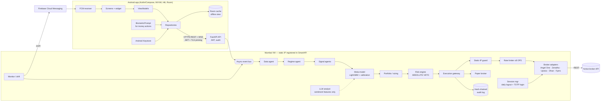

# AI Trading System — Architecture

Hybrid design required by SEBI's retail-algo / static-IP rules: **all orders leave from one
registered static IP (Mumbai VM)**. The Android app is a controller and viewer; it never holds
broker credentials or the TOTP secret.



## Order path (fail closed at every step)
`kill switch → mode → risk veto → (LIVE) static-IP check → rate limiter → broker → audit`

LIVE requires **three** locks: server env `ENGINE_ALLOW_LIVE=true`, typed confirmation phrase,
and (from the app) a biometric-gated request. The kill switch cancels working orders, drops
to PAPER and blocks re-arming until released.

## Repo layout
```
/engine     Python 3.11 FastAPI engine (Phase 1 done: broker layer + paper broker)
  app/core        enums, models, audit log, rate limiter, static-IP guard
  app/broker      Broker interface, PaperBroker, cost model, smartapi/{client,session,broker}
  app/execution   ExecutionGateway, risk veto contract
  tests/          pytest, SmartAPI fully mocked with respx
/android    Kotlin/Compose app, signed APK in android/dist/
/infra      VM bootstrap, Caddy, systemd, firewall (Phase 6)
/docs/trading   this document, BROKERS.md (multi-broker setup)
```

## Phases
| # | Scope | Status |
|---|-------|--------|
| 1 | Broker layer, paper broker, costs, compliance primitives | **done, 39 tests** |
| 2 | Data pipeline (corp actions, holidays, survivorship-free universe) + event-driven backtester | next |
| 3 | Regime, strategies, meta-labeling, sizing, full risk engine, validation suite | |
| 4 | API (REST/WSS, JWT) + Android core screens | **app done** (demo mode); engine API pending |
| 5 | FCM alerts, widget, AI analyst | widget + local alerts done; FCM pending |
| 6 | Deployment, TLS pinning, hardening | |
