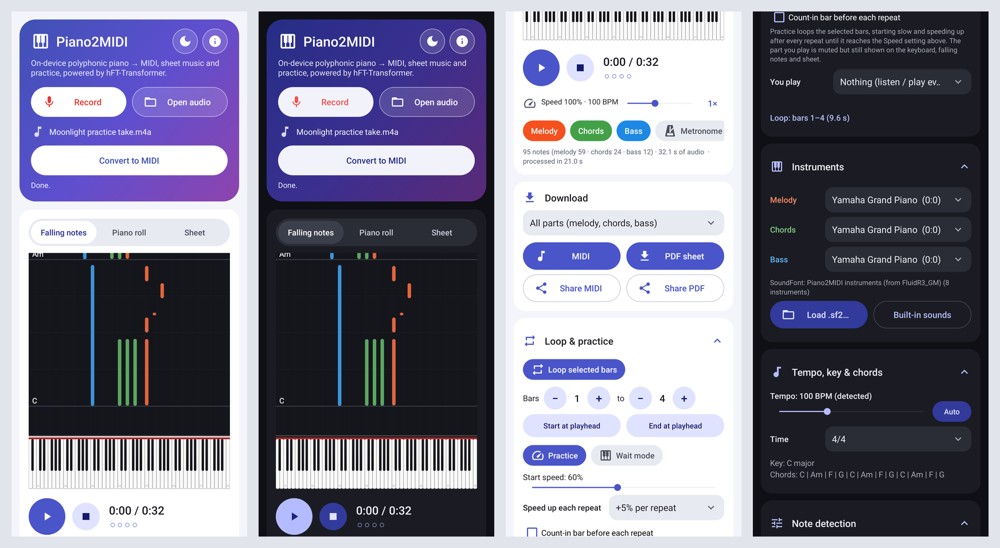

# Piano2MIDI: polyphonic audio → MIDI on Android

An Android app that converts piano recordings into MIDI files on the device, using
Sony's **hFT-Transformer** (Hierarchical Frequency-Time Transformer, ISMIR 2023,
[arXiv:2307.04305](https://arxiv.org/abs/2307.04305)) as the transcription engine.
No server or internet connection is needed.

```
audio file ─► MediaCodec decode ─► mono ─► resample 16 kHz ─► log-mel (256 bins, hop 256)
           ─► hFT-Transformer (ONNX Runtime, 128-frame windows + 32-frame margins)
           ─► onset / offset / frame / velocity per key ─► note decoding ─► .mid
```

## Features

- **Input:** mp3, m4a/aac, wav, flac, ogg/opus and anything else the device decoder supports, up to 10 minutes. You can also share audio straight into the app from another app ("Convert to MIDI").
- **Live microphone recording ("● Record piano"):** the app transcribes while you play. Each 2 s window runs through the model as soon as its 0.5 s of look-ahead audio has arrived, so notes appear 2–3 s after you play them, rising from the keyboard. A level meter shows the input. It uses the UNPROCESSED audio source when the device supports it (no voice noise-suppression or automatic gain). If the phone is slower than real time it catches up after you stop. The result is bit-identical to transcribing the saved recording as a file, and you can save the recording as `.wav`.
- **Transcription:** polyphonic, across all 88 piano keys, with velocity.
- **Melody, chords and bass:** every note is assigned to one of three parts (top line, accompaniment, lowest line). Checkboxes turn each part on or off for playback, display and the sheet.
- **Playback with SF2 instruments:** a built-in SoundFont synthesizer, written in Java, plays through AudioTrack. Each part gets its own instrument: Grand Piano, Electric Piano, Nylon or Steel Guitar, Violin, Flute, Acoustic or Fingered Bass. You can also **load any `.sf2` file** and choose from its presets.
- **Metronome and tempo change:** a metronome locked to the detected beat grid, with an accented first beat and sample-accurate clicks mixed into the synth output. There's an optional one-bar count-in, a beat indicator (● ○ ○ ○), and a speed control from 25% to 200% that shows the resulting BPM and applies live while playing. Keyboard, falling notes, roll and sheet cursor all follow the slowed-down or sped-up clock. On the desktop test, clicks land within 0.1 ms of the grid, and an 80% render transcribes back with the same accuracy against the time-scaled ground truth.
- **Loop and practice mode:** loop any bar range. Set it with the "Bars _ to _" steppers or "Start/End at playhead"; it's highlighted in the piano roll, falling notes and sheet. The wrap at the loop end is sample-accurate. Practice mode starts the loop slowly (25–100%) and speeds it up after each repeat (+5/10/20%) until it reaches the Speed setting. It can add a count-in bar before every repeat, and it can mute the part you play (melody, chords or bass) while still showing it. A repeat counter shows the current repeat and speed. On the desktop test, 4 practice loops at 60→80→100→100% wrap at exactly the expected times, and every note is reproduced (onset F1 1.000).
- **Wait mode:** playback stops at each note or chord of the part you play (or of every part) until you play it, then continues. The accompaniment waits with you, and pressing slightly early counts, so playing in time never stalls. Expected keys glow gold, wrong keys flash red, and correct and wrong counts are shown. Input can come from:
  - the on-screen keyboard;
  - a USB or Bluetooth MIDI keyboard, connected automatically through Android MIDI;
  - the microphone for an acoustic piano. A fast targeted detector looks at energy that has just appeared and runs iterative harmonic pitch estimation on it. It ignores pitches the app itself is playing, and accepts 3+-note chords with one note missed.

  Tests: simulated in-time players are never held up (29.5 s of audio for 29.1 s of music), late players are waited for at every chord, and wrong keys never advance. On synthetic piano chords the detector finds about 82–85% of expected notes within about 90 ms, with about 7% false alarms on unplayed pitches; single notes reach 93–98%.
- **Dark mode:** the Theme menu offers System default (follows Android's dark mode), Light or Dark. The dark palette covers cards, text, tabs, buttons and the system bars, and the sheet music becomes light ink on dark paper. Exported PDFs stay black on white. Switching themes keeps the transcription and all settings.
- **Splash screen animation:** the Android 12+ system splash on the brand colour continues into an animated intro (keys light up, notes rise, the title slides in) that fades into the app. It doesn't replay on theme switches.
- **App icon:** an adaptive icon with a gradient background, piano keys, a rising eighth note and piano-roll bars in the part colours. A monochrome layer lets Android 13+ themed icons work, and there is a round icon too ([preview](docs/icon-preview.png)).
- **Animated keyboard:** an 88-key keyboard where keys light up in their part's colour, sink while held and fade out on release. It stays in exact sync with the audio, and you can also tap it to play live with the melody instrument.
- **Three views:**
  - *Falling notes*: notes fall onto their keys, with bar lines and chord names.
  - *Piano roll*: coloured by part, with a chord lane and bar numbers. Tap it to jump to a position.
  - *Sheet*: piano sheet music with a playback cursor.
- **Piano sheet:** tempo, beat phase, downbeat, key (Krumhansl) and chords are detected automatically. Notes are quantized to 16ths and engraved on a grand staff (or a single staff for one part) with key signature, accidentals, beams, ties, rests, chord symbols and **8va / 8vb** octave brackets for very high or very low passages, using the Bravura music font. System spacing adapts to high or low notes. Tempo and time signature (4/4, 3/4, 2/4) can be adjusted.
- **Downloads:** **MIDI** or **PDF** for all parts, the selected parts, **melody only**, **chords only** or **bass line only**. MIDI files have one track per part, with the chosen instruments and a tempo map aligned to the detected bars. You can save anywhere or share to other apps.
- **Transcription engines:** you choose the engine on the Home page, and switching it resets every parameter to that engine's defaults. If a transcription is open, it is re-run with the new engine.
  - *hFT-Transformer* (default, best for piano, live streaming while you record).
  - *Basic Pitch* (Spotify; tiny, fast, any pitched instrument). Settings: onset 0.50, frame 0.30, minimum note 125 ms.
  - *MT3 piano* and *MT3 multi-instrument* (Google). These write finished notes, so there are no thresholds. Each is a 52 MB int8 ONNX download from `models/`, checked with SHA-256.
- **Detection settings:** adjustable onset, offset and frame thresholds and a note-end mode. Changing them re-decodes the notes instantly, without running the model again.



## Download

**[Piano2MIDI 1.8 for Android (arm64): Piano2MIDI-1.8-android-arm64.apk](https://github.com/Jayu8980/1./raw/ccr-0beb1834-f8votw/piano2midi/release/Piano2MIDI-1.8-android-arm64.apk)**
(49 MB, SHA-256 in `release/Piano2MIDI-1.8-android-arm64.apk.sha256`)

- Runs on Android 8.0 through Android 16, on 64-bit ARM phones and tablets.
- Supports 16 KB memory pages: ONNX Runtime 1.23.2 native libraries with 16 KB-aligned ELF segments.
- Signed with APK Signature Scheme v2 and v3 (debug key).

## Install

Download `piano2midi.apk`, either from the build artifacts of the **Piano2MIDI APK**
GitHub Actions workflow or by building it yourself (see below). Then install it with
"install unknown apps" allowed, or with `adb install piano2midi.apk`.
Requires Android 8.0 (API 26) or newer. ABIs: arm64-v8a, armeabi-v7a, x86_64.

The APK is signed with a debug key. To publish it, sign it with your own key.

## Accuracy and speed

The Java port was checked against the original Python code (`model/amt.py`,
torchaudio features, PyTorch model) on a FluidSynth-rendered polyphonic test piece
(99 notes: chords, bass, arpeggios):

| check | result |
| --- | --- |
| ONNX vs PyTorch outputs | max abs diff 1.3e-7, velocity argmax 100 % identical |
| Java log-mel vs torchaudio | max abs diff 7e-4 where there is signal (log domain) |
| Java notes vs Python `mpe2note` | identical: 95 notes, Δt ≤ 0.05 ms, same velocities |
| vs. ground-truth MIDI (mir_eval) | onset P/R/F1 0.989 / 0.949 / **0.969**, onset+offset F1 0.825 |

The other engines on the same piece (the Java ports were checked against the official Python code):

| engine | onset F1 | onset+offset F1 | notes |
| --- | --- | --- | --- |
| Basic Pitch | 0.806 | 0.464 | identical to `basic_pitch.inference` (112 notes) |
| MT3 piano (int8) | 0.912 | 0.667 | fp32 ONNX 0.931 = PyTorch port |
| MT3 multi-instrument (int8) | 0.980 | 0.880 | |

Speed: on a 4-core x86 desktop CPU a 2.048 s window takes about 1.3–1.6 s, so roughly
0.7× real time. Expect about 1–3× real time on recent phones and slower on older ones.
The app shows progress and an estimated time remaining, and you can cancel a run.

The model was trained on MAESTRO (solo grand piano), so it works best on solo
piano. Other instruments are transcribed as piano notes, with lower quality.

## Building

### Gradle / Android Studio (recommended)

```bash
cd piano2midi/android
./gradlew assembleRelease     # → app/build/outputs/apk/release/app-release.apk
```

The workflow `.github/workflows/piano2midi-apk.yml` runs this on every push that
touches `piano2midi/android/**` and uploads the APK as an artifact.

### Without the Android SDK

`android/build-local.sh` builds a signed APK using only Debian/Ubuntu packages
(`aapt`, `apksigner`, `zipalign`, a JDK). It downloads `android.jar`, the ONNX Runtime
AAR and D8 on first run:

```bash
sudo apt-get install aapt apksigner zipalign openjdk-17-jdk
piano2midi/android/build-local.sh   # → piano2midi/android/build/piano2midi.apk
```

### Verifying the music features

On the test pieces the analysis recovers the true tempo exactly (100 and 132 BPM), the
downbeat, the key (C major, E♭ major) and the chord progressions (C–Am–F–G in 4/4;
E♭–B♭–Cm–A♭ in a 3/4 waltz). Transcribing the synth's own rendering again gives the same
95 notes, which confirms the synth's pitch and timing. The tempo and chord detectors are
heuristics: for rubato or complex harmony, set the tempo by hand.

### Re-exporting the model

`app/src/main/assets/hft_transformer.onnx` is already included. To regenerate it from
the official checkpoint:

```bash
pip install torch onnx onnxruntime
wget https://github.com/sony/hFT-Transformer/releases/download/ismir2023/checkpoint.zip
unzip checkpoint.zip
python3 piano2midi/tools/export_onnx.py \
    --checkpoint checkpoint/MAESTRO-V3/model_016_003.pkl \
    --out piano2midi/android/app/src/main/assets/hft_transformer.onnx
```

The exported graph has input `spec [1,256,192]` and outputs the 2nd-stage
`onset`, `offset`, `mpe` `[1,128,88]` and `velocity` (argmax, int64). The reference
evaluation scripts use these same outputs.

### Desktop check

`tools/desktop/DesktopTranscribe.java` runs the same Java core on a desktop JVM, using
`com.microsoft.onnxruntime:onnxruntime` from Maven Central. Use it to transcribe a
WAV file or to compare results with the Python implementation.

## Project layout

| path | purpose |
| --- | --- |
| `android/app/src/main/java/com/hft/piano2midi/core/Resampler.java` | torchaudio-compatible sinc resampler |
| `.../core/FeatureExtractor.java` | STFT + slaney/htk mel filterbank + log, matching torchaudio |
| `.../core/Transcriber.java` | windowing/padding over the feature matrix (port of `AMT.transcript`) |
| `.../core/NoteDecoder.java` | peak picking and note assembly (port of `AMT.mpe2note`) |
| `.../core/MidiWriter.java` | Multi-track Standard MIDI File writer with a tempo map |
| `.../core/music/` | part splitting, tempo/downbeat, key and chord detection |
| `.../core/sheet/` | quantized score model and engraver (draws to Canvas, PDF or Java2D) |
| `.../core/synth/` | SoundFont 2 parser, sampler synth and note sequencer |
| `.../core/OnnxModel.java` | ONNX Runtime wrapper |
| `.../core/LiveTranscriber.java` | streaming resample → features → model chunks for the microphone |
| `.../MicRecorder.java` | AudioRecord capture (UNPROCESSED/16 kHz preferred) |
| `.../AudioDecoder.java` | MediaExtractor/MediaCodec decoder → mono float PCM |
| `.../SynthPlayer.java` | AudioTrack streaming, play position, live keys |
| `.../KeyboardView.java`, `FallingNotesView.java`, `PianoRollView.java`, `SheetView.java` | views |
| `.../PdfExporter.java`, `FileShareProvider.java`, `MainActivity.java` | export, sharing, UI |
| `tools/export_onnx.py`, `tools/model/` | checkpoint → ONNX export |
| `tools/make_soundfont.py` | cuts the built-in `instruments.sf2` out of FluidR3_GM |
| `tools/desktop/` | desktop CLI and Java2D renderer for testing the core |

## License

- App code in this folder: MIT.
- hFT-Transformer source code (`tools/model/model_spec2midi.py`, and the algorithms
  ported to Java): MIT, © 2023 Sony Group Corporation. See `tools/LICENSE-CODE`.
- Built-in instruments (`instruments.sf2`): an excerpt of FluidR3_GM by Frank Wen, MIT license.
  Rebuild it with `python3 tools/make_soundfont.py FluidR3_GM.sf2 android/app/src/main/assets/instruments.sf2 0 4 24 25 32 33 40 73`.
- Music font (`assets/fonts/Bravura.otf`): Bravura by Steinberg, SIL Open Font License 1.1
  (`assets/fonts/Bravura-OFL.txt`).
- Model weights (`hft_transformer.onnx`, converted from `model_016_003.pkl`):
  **CC BY-NC-SA 4.0**. They were trained on MAESTRO v3.0.0, so **non-commercial use only**,
  and modified copies must be shared under the same license. See `tools/LICENSE-CHECKPOINTS.md`.

Citation: K. Toyama, T. Akama, Y. Ikemiya, Y. Takida, W.-H. Liao, Y. Mitsufuji,
"Automatic Piano Transcription with Hierarchical Frequency-Time Transformer," ISMIR 2023.
